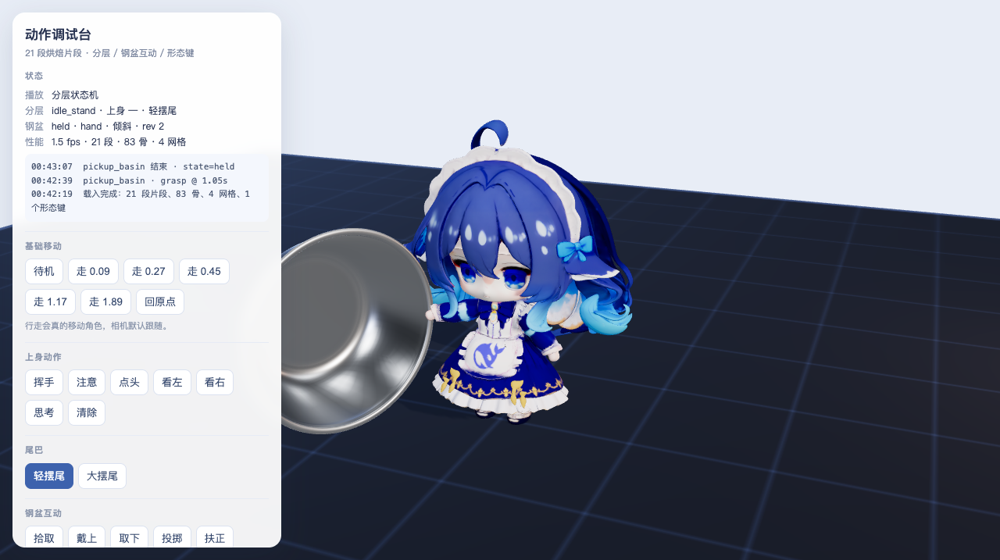
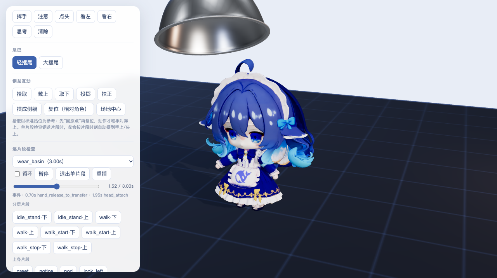

# 动作调试台（/animation.html）

2026-10-26 重做。原来的“调试模式”页还是 V9 时代的 10 段动作演示，按钮只有挥手/点头之类，钢盆相关的五个片段和形态键完全没法检查。现在这一页直接跑生产同一套模块（`LayeredMotionPlayer` + `BasinProp`），既是动作检查台，也是互动逻辑的手动验收台。

入口：主页面左上角“调试模式”，或直接访问 `http://192.168.0.100:8090/animation.html`。

## 面板分区

| 分区 | 能做什么 |
| --- | --- |
| 状态 | 当前播放（分层状态机 / 互动片段 / 单片段）、分层状态、钢盆 state·holder·正放与否·revision、帧率/片段数/骨骼/网格，以及事件日志 |
| 基础移动 | 待机、走 0.09 / 0.27 / 0.45 / 1.17 / 1.89（真实距离，含起步与收步）、回原点 |
| 上身动作 | 挥手、注意、点头、看左、看右、思考、清除 |
| 尾巴 | 轻摆尾 / 大摆尾 |
| 钢盆互动 | 拾取、戴上、取下、投掷、扶正、摆成侧躺、复位（相对角色）、场地中心 |
| 逐片段检查 | 21 段片段全部可单独播放：下拉框 + 播放/暂停/重播/循环 + 时间滑杆 + 事件时刻；下方按分层/上身/尾巴/钢盆分组，每个片段一个按钮 |
| 形态键 | 每个形态键一根滑杆（含 `Basin_v2_Wear_Crown_Tuck`），一键清零 |
| 相机 | 正面 / 45° / 侧面 / 背面，可开关跟随角色 |
| 跳转 | 返回主页面、钢盆沙盒 |

逐片段检查配合时间滑杆，可以看到戴盆的中间状态：盆在 1.4 秒时悬在手上与头顶之间。

## 单片段检查（solo）

- 走路类片段在资产里是 `.lower` / `.upperBase` 两段，面板里显示成“walk·下”“walk·上”，可以单独确认下半身和上半身。
- 单片段模式绕过分层状态机：其他动作权重全部置 0，只有被检查的片段以权重 1 播放。
- 时间滑杆会把动作暂停在该时刻（`setSoloTime`），配合事件时刻可以直接检查“1.05 秒抓取”这类关键帧。
- 空格键暂停/继续；滚轮缩放、拖动旋转。

## 和生产的差异

- 这一页不会连大脑服务，不会被 LLM 驱动；所有动作都要手动点。
- 拾取以标准站位为参考：先“回原点”“复位（相对角色）”，手的落点才和盆对得上。走动之后直接拾取，动作会照常播放，但手会离盆沿有一段距离。
- 单片段检查钢盆片段时，盆按片段时刻自动摆位（手 → 空中 → 头顶，投掷脱手后隐藏），只改视觉，不动状态机与物理。

## 验证记录

- 生产页面 21 个片段按钮逐个点击，全部进入对应 solo 播放（21/21）。
- 拾取流程：`grasp @1.05s` → 状态 `held · hand`，盆落在右手 `(-0.537, 0.416, 0.314)`，与离线矩阵计算一致。
- 拖拽时间滑杆到 0.8 s，播放头停在 0.800 s 且保持暂停。
- 钢盆片段逐帧核对：`wear_basin` 0.4 s 在手上 `(-0.537, 0.414, 0.315)`、1.3 s 在转移途中 `(-0.36, 1.409, 0.355)`、2.4 s 在头顶 `(0.002, 0.913, -0.065)`；`unwear_basin` 1.0 s 在头顶上方、2.5 s 回到手上；`throw_basin` 1.2 s 已脱手隐藏。
